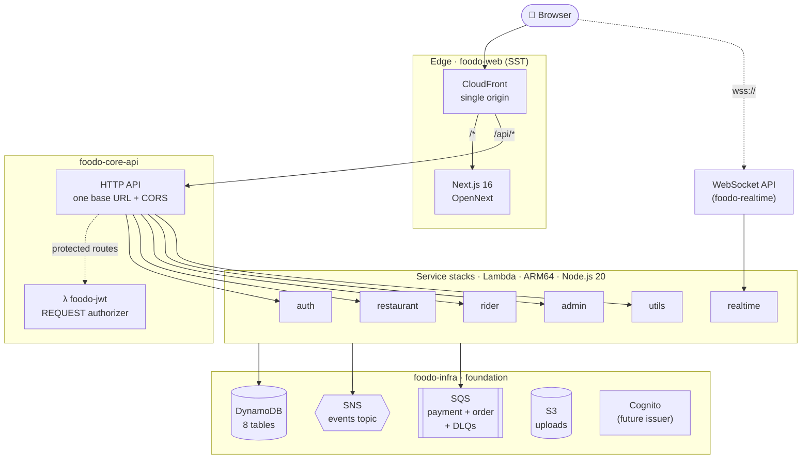
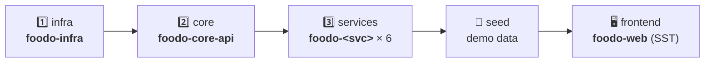
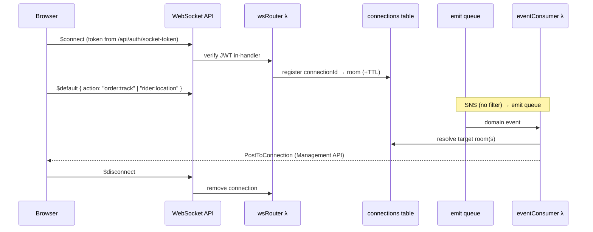
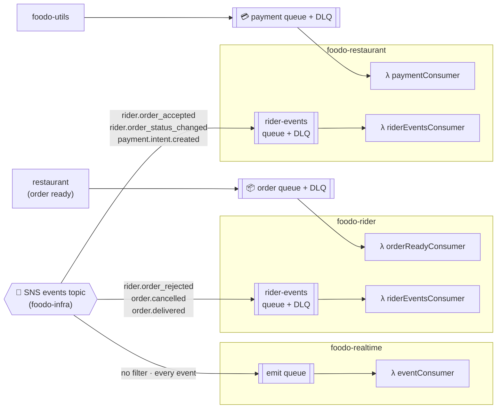
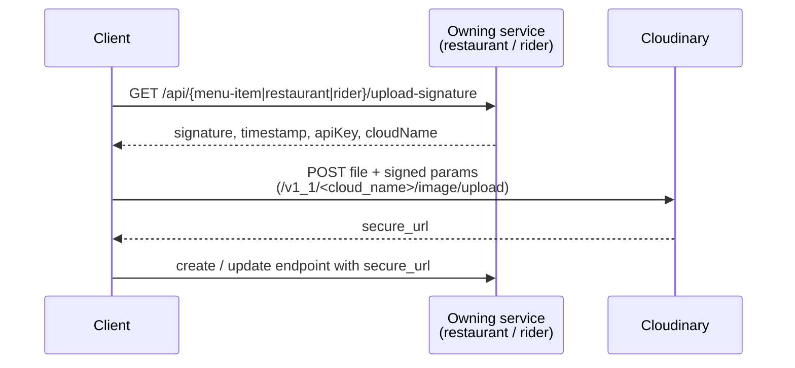

<div align="center">

# 🍽️ Foodo

### A serverless, multi-role food delivery platform on AWS

**Customers** · **Restaurant Owners** · **Delivery Riders** · **Platform Admins**


<br/>


<sub><b>Current architecture</b> — fully serverless on AWS</sub>

<br/>

[Overview](#overview) ·
[Architecture](#architecture) ·
[Shift Story](#shift-story) ·
[Deployment](#deployment) ·
[Services](#services) ·
[Events](#events) ·
[Database](#database) ·
[API](#api) ·
[Local Dev](#local-dev) ·
[Config](#config) ·
[Tech Stack](#tech-stack)

</div>

---

## 📑 Table of Contents

1. [Overview](#overview)
2. [Architecture](#architecture)
3. [The Shift Story: Local → Serverless](#shift-story)
4. [Repository Layout](#repo-layout)
5. [Deployment](#deployment)
6. [Services](#services)
7. [Events & Service Communication](#events)
8. [Database Schema](#database)
9. [API Reference](#api)
10. [Installation & Local Development](#local-dev)
11. [Configuration & Environment Variables](#config)
12. [Operations](#operations)
13. [Tech Stack](#tech-stack)
14. [Contributing & License](#contributing)

---

<a id="overview"></a>
## 🌟 Overview

Foodo started as a set of Express + MongoDB + RabbitMQ services on a developer box or EC2 and is now deployed entirely on **AWS serverless infrastructure**. Every domain is its own Serverless Framework stack with its own functions, IAM role and event wiring. Deploys run through a **Turborepo** pipeline in three ordered tiers, plus the frontend.

### 👥 Who uses it

| Role | What they do | Frontend route |
|---|---|---|
| 🛒 **Customer** | Discover restaurants, build a cart, order, pay, track delivery live | `/` |
| 🍳 **Seller** | Manage restaurant, menu and incoming orders | `/seller` |
| 🏍️ **Rider** | Accept orders and run the delivery lifecycle | `/rider` |
| 🛡️ **Admin** | Verify restaurants and riders, oversee the platform | `/admin` |

### ✨ Highlights

| | |
|---|---|
| 🧩 **One stack per domain** | Auth, Restaurant, Rider, Admin, Utils and Realtime deploy independently. |
| 🌐 **One base URL** | A single shared HTTP API serves `/api/*`, and CloudFront makes it same-origin for the browser. |
| 📨 **Event-driven** | An SNS event bus with filtered subscriptions, plus SQS work queues with DLQs. |
| 🔌 **Real-time push** | API Gateway WebSocket API with a DynamoDB connection registry. |
| 🖼️ **Signed direct uploads** | Images go browser → Cloudinary. The API secret never leaves the server and no bytes are proxied. |
| 🔐 **Central auth gate** | One Lambda REQUEST authorizer guards protected routes, and role checks stay in each service. |

### 🔢 Platform at a glance

| 6 service stacks | 8 DynamoDB tables | 2 SQS work queues + DLQs | 1 SNS event bus | 1 HTTP API + 1 WebSocket API |
|:-:|:-:|:-:|:-:|:-:|

### ⚡ Quick start

```bash
pnpm install                 # install the whole monorepo
# export secrets (see Configuration) or create .env.<stage> files
STAGE=dev pnpm deploy:all    # infra → core → services → seed → frontend
```

---

<a id="architecture"></a>
## 🏗️ Architecture



### 🧭 Key architectural decisions

| Decision | Replaces | How it works |
|---|---|---|
| **Single shared HTTP API** | Six Express ports | One API Gateway v2 HTTP API is the only base URL. Each stack attaches routes by `id`. CORS lives on the API because service stacks can't extend it. |
| **Central REQUEST authorizer** | Per-service JWT middleware at the edge | `foodo-jwt` verifies the HS256 token from the `session` cookie (cookie-session: base64 JSON with a `jwt` field) or an `Authorization: Bearer` header. It returns `{ isAuthorized, context }`. It **authenticates only**. Role checks (`isSeller` / `isRider` / `isAdmin`) stay in each service. |
| **SNS + SQS** | RabbitMQ | SQS work queues carry cross-service transport. After `maxReceiveCount` failures a message lands in a DLQ. SNS is the domain event bus with per-service filtered subscriptions. |
| **DynamoDB** | Shared MongoDB | Each service reads and writes only its own tables via AWS SDK v3, with per-service IAM scoped to exactly those tables. |
| **WebSocket API** | Socket.IO server | `wsRouter` handles `$connect/$disconnect/$default`. `eventConsumer` fans domain events out to rooms via the Management API. Connection state lives in a TTL'd `connections` table. |
| **Signed direct uploads** | Multer proxy in Utils | The owning service signs locally (HMAC-SHA1, <1 ms). The browser uploads straight to Cloudinary. |
| **EventBridge Scheduler** | In-process `setInterval` | A `reconcile` Lambda in the utils stack runs on `rate(1 hour)`. |

> [!NOTE]
> **Identity migration path.** The app issues its own HS256 access tokens today (signed with `JWT_SECRET`), and the authorizer verifies them. The foundation stack already ships a **Cognito user pool + web client**. When auth-service moves to Cognito-issued tokens, the authorizer flips to JWKS verification (or the HTTP API's built-in Cognito authorizer) with no infrastructure changes in this stack.

### 🔓 What is intentionally public at the gateway

| Surface | Why it's public |
|---|---|
| `/api/auth/*` (register, login, refresh) | Token issuance. No access token exists yet. |
| `GET /api/restaurant/all` · `/nearby` · `/{id}` · `GET /api/menu-item/all/{id}` | Anonymous browsing. |
| `POST /api/order/payment/claim/{orderId}` | Service-to-service, guarded by `x-internal-key`. |
| `/api/utils/*` | Webhook HMAC signatures and controller-validated claims. |
| `/health/*` | Probes. |
| WebSocket `$connect` | JWT verified inside the handler. |

> [!IMPORTANT]
> Gateway denies return **403** (API Gateway simple-response semantics). In-app guards still return **401**, as before.

---

<a id="shift-story"></a>
## 🔄 The Shift Story: Local → Serverless

### 📍 Where we started

<div align="center">


<sub><b>Previous architecture</b> — what we migrated away from</sub>

</div>

<br/>

Foodo originally ran as Node.js/Express microservices on one shared MongoDB, with RabbitMQ for async events and Socket.IO for real-time push. Everything ran as `node` processes on a developer machine, in a Vagrant VM, or on a long-lived EC2 instance.

| Component | Port | Stack |
|---|:-:|---|
| Next.js frontend | 3000 | Next.js |
| Auth Service | 3000 | Express + Mongoose, MongoDB |
| Restaurant Service | 3001 | Express + Mongoose, MongoDB, RabbitMQ |
| Realtime Service | 3002 | Express + Socket.IO |
| Rider Service | 3003 | Express + Mongoose, MongoDB, RabbitMQ |
| Admin Service | 3004 | Express + native MongoDB driver |
| Utils Service | 3005 | Express + Razorpay/Stripe, RabbitMQ |

### 🧱 Why we changed it

| Pain point | Impact |
|---|---|
| **Long-lived servers** | Patching, scaling and monitoring several services per host. Scaling one meant resizing the whole box. |
| **Shared MongoDB** | A bottleneck and a shared blast radius. No per-service data boundary. |
| **RabbitMQ cluster** | We owned durability, clustering and failover. |
| **Socket.IO process** | Real-time needed its own always-on server. |
| **Multer upload proxy** | Bytes flowed client → Utils → Cloudinary, so the API secret lived wherever the proxy ran and the backend had to stay warm. |
| **Stateful deploys** | A release meant coordinated restarts of several processes. |

### 🚀 Where we are now

| What we had | What it became |
|---|---|
| Express services on EC2/Vagrant | **Lambda per domain** (ARM64, Node.js 20), individually packaged |
| Shared MongoDB (Mongoose + native driver) | **8 DynamoDB tables** (single-table-per-entity) in the foundation stack, accessed via `@aws-sdk/client-dynamodb` + `lib-dynamodb` |
| RabbitMQ queues + pub/sub | **SQS work queues** (payment, order) with DLQs, plus an **SNS** event bus with filtered subscriptions |
| Socket.IO server | **API Gateway WebSocket API** + Lambda handlers + a `connections` table + an event consumer broadcasting via the Management API |
| Upload proxy through Utils | **Signed direct uploads**. Restaurant and rider sign locally via `@foodo/backend-common`. `POST /api/utils/upload` answers **410 Gone** |
| Payment polling / in-process timers | **EventBridge Scheduler** → `reconcile` Lambda, `rate(1 hour)` |
| Restart-everything releases | **Per-stack deploys**. Turborepo chains each service's cached `build` before `serverless deploy` |

### 🧷 What didn't change (on purpose)

- **HTTP contract.** One base URL with `/api/auth|restaurant|rider|admin|utils/*` and `/api/menu-item|cart|order|address/*`. API Gateway + Lambda now serve it instead of raw Express ports.
- **Stateless JWT auth.** Role checks still live inside each service, not at the gateway.
- **Event vocabulary.** `rider.order_accepted`, `rider.order_status_changed`, `payment.intent.created`, `rider.order_rejected`, `order.cancelled`, `order.delivered`.
- **Order lifecycle.**

  ```
  placed → accepted → preparing → ready_for_rider → rider_assigned → picked_up → delivered | cancelled
  ```
- **Frontend stack.** Next.js 16 / React 19, Tailwind CSS v4, Shadcn UI, TanStack Query, Zustand.

> The surface the app presents to a browser is unchanged. The machinery underneath is now event-driven, stateless and fully managed.

---

<a id="repo-layout"></a>
## 📁 Repository Layout

pnpm workspaces + Turborepo monorepo:

```
Foodo/
├── apps/
│   └── web/                     # Next.js 16 app, deployed with SST (foodo-web)
│       ├── src/
│       │   ├── app/             # App Router: (auth) (customer) admin rider seller
│       │   ├── components/      # UI & shared components
│       │   ├── features/        # auth, orders, restaurants
│       │   ├── hooks/ lib/ providers/ store/ types/
│       ├── sst.config.ts        # OpenNext + CloudFront reverse proxy
│       └── next.config.ts
├── backend/
│   ├── auth-service/            # foodo-auth
│   ├── restaurant-service/      # foodo-restaurant
│   ├── rider-service/           # foodo-rider
│   ├── admin-service/           # foodo-admin
│   ├── utils-service/           # foodo-utils
│   └── realtime-service/        # foodo-realtime
│       └── (each) src/ · serverless.yml · package.json · tsconfig.json
├── packages/
│   ├── types/                   # @foodo/types: shared TS types, 0 runtime deps
│   └── backend-common/          # @foodo/backend-common: signer, tryCatch, isAuth, file helpers
├── infra/                       # foodo-infra: foundation stack (Serverless)
├── core/                        # foodo-core-api: shared HTTP API + JWT authorizer
│   └── src/authorizer.ts
├── scripts/seed-demo-data.ts    # demo data (runs after deploy)
├── turbo.json                   # build · dev · lint · deploy · remove
├── pnpm-workspace.yaml          # workspaces + version catalog
└── tsconfig.base.json
```

---

<a id="deployment"></a>
## ☁️ Deployment

### 🪜 Three ordered tiers (plus the frontend)

Serverless resolves all paths against the config's directory, so every stack is self-contained.



| Tier | Directory | Stack | Owns |
|:-:|---|---|---|
| **1** | `infra/` | `foodo-infra` | VPC (2 AZs, S3 + DynamoDB gateway endpoints, opt-in NAT), private S3 uploads bucket, Cognito pool + web client, **8 DynamoDB tables**, SNS event bus, SQS work queues (payment, order) + DLQs |
| **2** | `core/` | `foodo-core-api` | Shared HTTP API (single base URL + CORS) and the central JWT REQUEST authorizer Lambda |
| **3** | `backend/<svc>/` | `foodo-<svc>` | Functions, per-service IAM, own fan-out queues + SNS subscriptions + filter policies, and the WebSocket API (realtime only) |
| **+** | `apps/web/` | `foodo-web` | Next.js via SST Ion / OpenNext on CloudFront, with a reverse-proxy origin to the HTTP API |

### ▶️ Deploy commands

```bash
pnpm deploy:infra       # VPC, S3, Cognito, DynamoDB, SNS, SQS   (rarely changes)
pnpm deploy:core        # shared HTTP API + JWT authorizer       (rarely changes)
pnpm deploy:services    # ALL six service stacks (turbo, parallel)
pnpm deploy:frontend    # Next.js via SST Ion / OpenNext

pnpm deploy:all         # everything: infra → core → services → seed → frontend
STAGE=prod pnpm deploy:all
```

Deploy a **single service**. Turbo runs its cached `build` first:

```bash
turbo run deploy --filter=@foodo/auth-service
turbo run deploy --filter=@foodo/restaurant-service -- --stage prod
```

### 🗑️ Teardown

```bash
pnpm remove:all         # removes services FIRST, then the rest
```

> [!WARNING]
> **Order matters.** Removing `core-api` while service routes still exist fails. Removing `infra` while any stack still reads its exports fails. Always tear down in reverse: `frontend → services → core → infra`. The uploads bucket uses `DeletionPolicy: Retain`, so delete it manually if you really mean it.

### 🔑 Secrets (deploy time, never committed)

Pass them via environment variables or per-stack `.env.<stage>` files. See [Configuration](#config) for the full list and which stack needs which.

> [!IMPORTANT]
> Use the **same values across all stacks** in a stage. The JWT authorizer in `core` must verify the tokens `auth-service` mints.

### 🔄 Cutover from the old stacks

If you previously deployed the old `foodo-core` / `foodo-services` stacks:

1. **Remove the old service stacks first.** They own routes on the shared API. Run `serverless remove` in the old directories.
2. **Migrate data manually.** The old `foodo-core` data stack kept its tables, and the new `foodo-infra` stack creates **fresh** tables under new names. There is no in-place upgrade.
3. **Repoint the frontend** to the new base URL (`foodo-core-api-<stage>-HttpApiUrl`) and the WS URL from the realtime stack.

---

<a id="services"></a>
## 🔧 Services

### 🗺️ What runs where

| Service | Stack | Lambda entrypoints (`dist/`) | Triggers |
|---|---|---|---|
| 🔐 **Auth** | `foodo-auth` | `index` | HTTP `/api/auth/*` |
| 🍽️ **Restaurant** | `foodo-restaurant` | `http`, `paymentConsumer`, `riderEventsConsumer` | HTTP (5 routers) + payment work queue + SNS fan-out |
| 🏍️ **Rider** | `foodo-rider` | `http`, `orderReadyConsumer`, `riderEventsConsumer` | HTTP `/api/rider/*` + order work queue + SNS fan-out |
| 🛡️ **Admin** | `foodo-admin` | `index` | HTTP `/api/admin/*` |
| 💳 **Utils** | `foodo-utils` | `http`, `reconciliation` (function `reconcile`) | HTTP `/api/utils/*` + EventBridge `rate(1 hour)` |
| 🔌 **Realtime** | `foodo-realtime` | `wsRouter`, `eventConsumer` | WebSocket routes + SNS fan-out → Management API |

### 🔒 Data access matrix (per-service IAM)

| Service | users | restaurants | riders | orders | menu-items | carts | addresses | webhook-dedupe |
|---|:-:|:-:|:-:|:-:|:-:|:-:|:-:|:-:|
| **auth** | ✅ | | | | | | | |
| **restaurant** | | ✅ | | ✅ | ✅ | ✅ | ✅ | |
| **rider** | | ✅ | ✅ | ✅ | | | | |
| **admin** | ✅ | ✅ | ✅ | ✅ | | | | |
| **utils** | | | | ✅ | | | | ✅ |
| **realtime** | *owns its own `connections` table* | | | | | | | |

All access goes through each table's indexes where needed. Every service also gets only the SNS/SQS permissions it uses.

---

### 1️⃣ 🔐 Auth Service

> Registration, login, refresh, logout, profile and WebSocket token issuance.

| | |
|---|---|
| **Stack / entry** | `foodo-auth` · `dist/index.handler` |
| **Runtime** | ARM64 · Node.js 20 · 512 MB · 15 s |
| **Data** | `users` table: `GetItem`, `PutItem`, `UpdateItem`, `Query` + indexes `email-index`, `refresh-index` |
| **Events** | Publishes to the SNS `events` topic (e.g. on registration) |
| **Sessions** | Refresh-token rows carry a per-item `ttl`, so DynamoDB sweeps expired sessions automatically |

**Routes:** `register` and `login` are public (token issuance). `logout`, `me` and `socket-token` are JWT-protected at the gateway *and* in-app (defense in depth). `/api/auth/{proxy+}` is a public catch-all for the rest (refresh, etc.). Full table in the [API Reference](#api).

---

### 2️⃣ 🍽️ Restaurant Service

> Restaurants, menu items, carts, orders, payment claim and rider-event consumption.

| | |
|---|---|
| **Stack / entry** | `foodo-restaurant` · `http`, `paymentConsumer`, `riderEventsConsumer` |
| **Runtime** | ARM64 · Node.js 20 · 512 MB · 15 s (30 s for consumers) |
| **Data** | `restaurants`, `orders`, `menu-items`, `carts`, `addresses`: `GetItem`, `PutItem`, `UpdateItem`, `DeleteItem`, `Query` + indexes |

**Event wiring**
- 📤 Publishes **order-ready** messages to the shared `order` SQS queue and domain events to the `events` SNS topic.
- 📥 Consumes the shared `payment` SQS queue directly (`paymentConsumer`, batch size 5, partial batch responses).
- 📥 Owns its inbound `rider-events` queue + DLQ + SNS filter subscription for `rider.order_accepted`, `rider.order_status_changed` and `payment.intent.created`.

**Image uploads:** `GET /api/restaurant/upload-signature` (and `/api/menu-item/upload-signature`) returns Cloudinary signature params generated locally via `@foodo/backend-common`. Legacy multipart `file` on create/update endpoints still works as a fallback via the same signer.

---

### 3️⃣ 🏍️ Rider Service

> Rider profiles, order acceptance, delivery lifecycle, order-ready consumption and saga compensations.

| | |
|---|---|
| **Stack / entry** | `foodo-rider` · `http`, `orderReadyConsumer`, `riderEventsConsumer` |
| **Runtime** | ARM64 · Node.js 20 · 512 MB · 15 s (30 s for consumers) |
| **Data** | `riders`, `orders`, `restaurants`: `GetItem`, `PutItem`, `UpdateItem`, `Query` + indexes |

The rider router applies `isAuth` + `isRider` to the **entire** `/api/rider` surface (including rider registration, preserved from current app semantics), so a single protected catch-all covers it at the gateway.

**Event wiring**
- 📥 Consumes the shared `order` SQS queue directly (`orderReadyConsumer`, batch size 5, partial batch responses).
- 📥 Owns its inbound `rider-events` queue + DLQ + SNS filter subscription for `rider.order_rejected`, `order.cancelled` and `order.delivered` (saga compensations).

**Image uploads:** `GET /api/rider/upload-signature` (signed locally via `@foodo/backend-common`).

---

### 4️⃣ 🛡️ Admin Service

> Platform administration: verify restaurants and riders, with read access to users and orders.

| | |
|---|---|
| **Stack / entry** | `foodo-admin` · `dist/index.handler` |
| **Runtime** | ARM64 · Node.js 20 · 512 MB · 15 s |
| **Data** | `users`, `restaurants`, `riders`, `orders`: `GetItem`, `UpdateItem`, `Query`, `Scan` + indexes |

The admin router applies `isAuth` + `isAdmin` to every route, so one protected catch-all (`/api/admin/{proxy+}`) covers the surface. The old native-driver pattern is replaced by SDK v3 queries against the shared foundation tables.

---

### 5️⃣ 💳 Utils Service

> Payments (Razorpay, Stripe), reconciliation and webhook dedupe. It no longer proxies file uploads.

| | |
|---|---|
| **Stack / entry** | `foodo-utils` · `http`, `reconciliation` |
| **Runtime** | ARM64 · Node.js 20 · 512 MB · 15 s (reconcile: 256 MB · 120 s) |
| **Data** | `orders`, `webhook-dedupe`: `GetItem`, `UpdateItem`, `PutItem`, `Query` |
| **Events** | Publishes to the SNS `events` topic and sends to the shared `payment` SQS queue |

- **Why `/api/utils/*` is fully public at the gateway:** payment webhooks are the source of truth for payment success. They authenticate with provider **HMAC signatures** (Razorpay/Stripe) over raw bodies, not user sessions. Payment-create endpoints validate order state atomically in the controller.
- **Reconciliation:** the `reconcile` Lambda runs on an EventBridge Scheduler `rate(1 hour)`. It audits provider-vs-DB payment state using `RAZORPAY_KEY_ID`, `RAZORPAY_KEY_SECRET` and `STRIPE_SECRET_KEY`.
- **Webhook dedupe:** `webhook-dedupe` carries a `ttl`, so processed event ids are swept automatically.

---

### 6️⃣ 🔌 Realtime Service

> WebSocket push notifications on API Gateway WebSockets.

| | |
|---|---|
| **Stack / entry** | `foodo-realtime` · `wsRouter`, `eventConsumer` |
| **Runtime** | ARM64 · Node.js 20 · 256 MB · 30 s |
| **Owns** | Its own **WebSocket API + stage**, its own **`connections` table** (ephemeral runtime state, not in the shared data tier) and its own inbound **`emit`** queue + unfiltered SNS subscription |
| **Frontend URL** | `foodo-realtime-<stage>-WebSocketUrl` export (`wss://…`) |



| Handler | Role |
|---|---|
| `$connect` | JWT verified in-handler, auto room joins, connection stored with `room` + TTL |
| `$disconnect` | Connection removed from the `connections` table |
| `$default` | Client actions routed by `action` in the body (`order:track`, `rider:location`) |
| `eventConsumer` | Consumes **every** domain event (no filter, like the old fanout exchange) and broadcasts to rooms |

---

### 7️⃣ 🖥️ Frontend

> Next.js 16 multi-role web app, deployed with SST Ion's native OpenNext integration on CloudFront.

| | |
|---|---|
| **Stack** | `foodo-web` (SST) |
| **Framework** | Next.js 16 · React 19 |
| **UI / state** | Tailwind CSS v4 · Shadcn UI (Radix) · TanStack Query · Zustand |
| **Deploy** | `sst deploy` (OpenNext → CloudFront) |

**🌐 Zero-cost reverse proxy (single origin).** The app runs at `https://<id>.cloudfront.net/`. Browser calls to relative `/api/*` flow through the same CloudFront origin to the HTTP API, so there is **no custom domain, no CORS issues, and cookies stay first-party and same-origin**.

| Request | Origin | Behavior |
|---|---|---|
| `/api/*` | `ApiGatewayBackend` → deployed `foodo-core-api` HTTP API URL | Caching disabled, all viewer methods allowed |
| Everything else | Next.js (OpenNext) | Default |

SST reads live endpoints from CloudFormation exports at deploy time (`foodo-core-api-<stage>-HttpApiUrl`, `foodo-realtime-<stage>-WebSocketUrl`), with stage-default fallbacks.

| Route | Role | Description |
|---|---|---|
| `/` | Customer | Restaurant discovery homepage |
| `/login` | All | Login |
| `/register` | All | Registration with role selection |
| `/seller` | Seller | Restaurant owner dashboard |
| `/rider` | Rider | Delivery rider mobile interface |
| `/admin` | Admin | Platform admin control panel |

---

<a id="events"></a>
## 🎯 Events & Service Communication

### 📨 Event topology

Each service **owns** its inbound queue, its DLQ and its SNS subscription (including the queue policy that lets SNS deliver). The **work queues** stay in the foundation stack because their producers and consumers are different services.



| Mechanism | Producer(s) | Consumer | Purpose |
|---|---|---|---|
| **payment** SQS queue | utils | restaurant `paymentConsumer` | Payment results into order flow |
| **order** SQS queue | restaurant | rider `orderReadyConsumer` | Order ready for a rider |
| SNS → restaurant `rider-events` | rider, utils | restaurant `riderEventsConsumer` | Rider progress and payment intent updates |
| SNS → rider `rider-events` | restaurant, rider | rider `riderEventsConsumer` | Saga compensations |
| SNS → realtime `emit` | all | realtime `eventConsumer` | Live push to browsers |

### 🖼️ Image uploads (signed direct upload, no utils-service hop)



- Signatures are **HMAC-SHA1 over sorted params** (`@foodo/backend-common`). They are purely local, take <1 ms, and are bound to the exact server-chosen folder and params.
- `CLOUDINARY_API_SECRET` **never leaves the signing service**. Clients only receive `signature`, `timestamp`, `apiKey` and `cloudName`.
- Multipart `file` uploads to create/update endpoints still work as a legacy fallback. `POST /api/utils/upload` returns **410 Gone**.

### 🤝 Internal communication rules

- Service-to-service HTTP calls authenticate with an `x-internal-key` header matching `INTERNAL_SERVICE_KEY` (e.g. `/api/order/payment/claim/{orderId}`).
- SNS is the domain event bus, with per-service filtered subscriptions.
- SQS work queues carry cross-service transport. Each service owns its fan-out queue + DLQ + SNS subscription.
- Realtime publishes to rooms through the API Gateway Management API, and the `connections` table maps `connectionId → room`.

---

<a id="database"></a>
## 📊 Database Schema

All shared tables live in the foundation stack (`foodo-infra`). Each is **single-table-per-entity** with a `pk`/`sk` key schema plus the indexes each query path needs. The `connections` table is owned by the realtime stack.

| Table | Key pattern (`pk` = `sk`) | Indexes (GSI) | TTL | Accessed by |
|---|---|---|:-:|---|
| **users** | `USER#<userId>` | `email-index` (email), `refresh-index` (tokenHash) | ✅ refresh tokens | auth, admin |
| **restaurants** | `RESTAURANT#<id>` | `owner-index` (ownerId), `verified-index` (isVerified 0\|1) | | restaurant, rider, admin |
| **riders** | `RIDER#<id>` | `user-index` (userId), `verified-index` (isVerified 0\|1) | | rider, admin |
| **orders** | `ORDER#<id>` | `user-orders`, `restaurant-orders`, `rider-orders`, `status-board`, `payment-status` | ✅ unpaid, 15-min window | restaurant, rider, admin, utils |
| **menu-items** | `MENU_ITEM#<id>` | `restaurant-index` (restaurantId) | | restaurant |
| **carts** | `CART#<userId>#<restaurantId>#<itemId>` | none | | restaurant |
| **addresses** | `ADDRESS#<id>` | none | | restaurant |
| **webhook-dedupe** | `<eventId>` (pk only) | none | ✅ | utils |
| *connections* (realtime-owned) | `connectionId` → `room` | none | ✅ | realtime |

<details>
<summary><b>📦 Entity fields & index details</b> (click to expand)</summary>

<br/>

**Users**: `email`, `tokenHash`, role and profile fields. Refresh-token rows carry a per-item `ttl`. Auth-service owns this table.

**Restaurants**: `name`, `description`, `image`, `ownerId`, `phone`, `isVerified`, `isOpen`, `autoLocation` (lng/lat + formattedAddress).

**Riders**: `userId`, `picture`, `phoneNumber`, `addharNumber`, `drivingLicenseNumber`, `isVerified`, `isAvailable`, `location` (lng/lat), `lastActive`.

**Orders**
- Fields: `userId`, `restaurantId`, `restaurantName`, `riderId`, `riderName`, `riderPhone`, `distance`, `riderAmount`, `items` (itemId/name/price/quantity), `subtotal`, `deliveryFee`, `platformFee`, `totalAmount`, `addressId`, `deliveryAddress` (formattedAddress/mobile/latitude/longitude), `status`, `paymentMethod`, `paymentStatus`, `expiresAt`.
- Indexes:

  | GSI | Partition key | Sort key |
  |---|---|---|
  | `user-orders` | `userId` | `createdAt` |
  | `restaurant-orders` | `restaurantId` | `createdAt` |
  | `rider-orders` | `riderId` | `createdAt` |
  | `status-board` | `status` | `createdAt` |
  | `payment-status` | `paymentStatus` | `paymentIntentInitiatedAt` |

**Menu items**: `restaurantId`, `name`, `description`, `price`, `image`, `isAvailable`.

**Carts**: `userId`, `restaurantId`, `itemId`, `quantity`.

**Addresses**: `userId`, `mobile`, `formatterAddress`, `location` (lng/lat).

**Webhook dedupe**: `pk = <eventId>`, `ttl = <expiry>`. Used to dedupe payment webhooks.

</details>

---

<a id="api"></a>
## 📡 API Reference

**Legend:** 🔓 Public at the gateway · 🔒 JWT-protected at the gateway (the authorizer authenticates, services authorize roles)

> [!TIP]
> API Gateway routes to the **most specific** matching route. Protected routes like `/api/restaurant/my` and `/api/restaurant/upload-signature` are declared **explicitly** so the public `GET /api/restaurant/{id}` doesn't swallow them.

### 🔐 Auth

| Method | Endpoint | Access | Notes |
|:-:|---|:-:|---|
| POST | `/api/auth/register` | 🔓 | Token issuance |
| POST | `/api/auth/login` | 🔓 | Token issuance |
| POST | `/api/auth/logout` | 🔒 | Gateway + in-app |
| GET | `/api/auth/me` | 🔒 | Gateway + in-app |
| GET | `/api/auth/socket-token` | 🔒 | For the WebSocket handshake |
| `*` | `/api/auth/{proxy+}` | 🔓 | Remaining auth routes (refresh, etc.) |

### 🍽️ Restaurant service (restaurants · menu · cart · order · address)

| Method | Endpoint | Access | Notes |
|:-:|---|:-:|---|
| GET | `/api/restaurant/all` | 🔓 | Anonymous browsing |
| GET | `/api/restaurant/nearby` | 🔓 | Anonymous browsing |
| GET | `/api/restaurant/{id}` | 🔓 | Anonymous browsing |
| GET | `/api/menu-item/all/{id}` | 🔓 | Anonymous browsing |
| POST | `/api/order/payment/claim/{orderId}` | 🔓 | Service-to-service, `x-internal-key` |
| GET | `/health/restaurant` | 🔓 | Probe |
| GET | `/api/restaurant/my` | 🔒 | Explicit, not caught by `/{id}` |
| GET | `/api/restaurant/upload-signature` | 🔒 | Explicit, signed direct upload |
| `*` | `/api/restaurant/{proxy+}` | 🔒 | |
| `*` | `/api/menu-item/{proxy+}` | 🔒 | Includes `upload-signature` |
| `*` | `/api/cart/{proxy+}` | 🔒 | |
| `*` | `/api/order/{proxy+}` | 🔒 | |
| `*` | `/api/address/{proxy+}` | 🔒 | |

### 🏍️ Rider service

| Method | Endpoint | Access | Notes |
|:-:|---|:-:|---|
| `*` | `/api/rider/{proxy+}` | 🔒 | Entire surface (includes `upload-signature` and rider registration) |
| GET | `/health/rider` | 🔓 | Probe |

### 🛡️ Admin service

| Method | Endpoint | Access | Notes |
|:-:|---|:-:|---|
| `*` | `/api/admin/{proxy+}` | 🔒 | Entire surface |
| GET | `/health/admin` | 🔓 | Probe |

### 💳 Utils service

| Method | Endpoint | Access | Notes |
|:-:|---|:-:|---|
| `*` | `/api/utils/{proxy+}` | 🔓 | Webhook HMAC + controller-validated claims |
| GET | `/health/utils` | 🔓 | Probe |
| POST | `/api/utils/upload` | 🔓 | **410 Gone**, replaced by signed direct uploads |

### 🔌 Realtime (WebSocket API)

| Route | Access | Purpose |
|---|:-:|---|
| `$connect` | JWT (in-handler) | Handshake, auto room joins |
| `$disconnect` | n/a | Connection cleanup |
| `$default` | n/a | Client actions (`order:track`, `rider:location`) |

---

<a id="local-dev"></a>
## 💻 Installation & Local Development

### ✅ Prerequisites

| Tool | Version |
|---|---|
| Node.js | ≥ 20 |
| pnpm | ≥ 10 (`corepack enable` or `npm i -g pnpm`) |
| AWS credentials | Configured (for `serverless deploy` / `sst deploy`) |
| Serverless Framework | v3 (via the workspace `serverless` catalog entry) |
| TypeScript | 5.x (shared via workspace catalog) |

### 📥 Install

One command from the repo root installs everything through workspace symlinks:

```bash
pnpm install
```

### 🧪 Two ways to run Foodo

| | ☁️ **Canonical: serverless** | 💻 **Local: legacy shape** |
|---|---|---|
| Compute | Lambda behind API Gateway | Long-running Express processes |
| Data | DynamoDB | MongoDB (`mongod`) |
| Messaging | SNS + SQS | RabbitMQ |
| Realtime | WebSocket API | Socket.IO |
| Command | `pnpm deploy:all` | `pnpm dev` |

The frontend contract is identical either way: a single base URL with the same `/api/*` paths. Only the backing resource changes.

### ▶️ Running locally (legacy shape)

```bash
# 1. start backing services
mongod
rabbitmq-server

# 2. start all services + web (turbo, shared terminal)
pnpm dev

# or scope to one workspace
pnpm --filter @foodo/auth-service dev
pnpm --filter web dev
```

- Each service needs its own `.env` in its directory (see [Configuration](#config)).
- Local image uploads still flow through the backend. Setting `CLOUDINARY_URL` in restaurant/rider lets the signer work locally too.

---

<a id="config"></a>
## 🔐 Configuration & Environment Variables

### 🔑 Deploy-time secrets

Passed via environment or `.env.<stage>` in each stack's directory. **Keep values identical across all stacks in a stage.**

| Variable | Used by | Description |
|---|---|---|
| `JWT_SECRET` | all service stacks, core-api (infra reserved for Cognito migration) | JWT signing secret. Must be identical everywhere in a stage |
| `COOKIE_SECRET` | auth, restaurant, admin, realtime, utils | Cookie-session encryption key |
| `INTERNAL_SERVICE_KEY` | restaurant, rider, utils | Shared key for inter-service auth (`x-internal-key`) |
| `REFRESH_COOKIE_NAME` | auth | Refresh-token cookie name |
| `RAZORPAY_KEY_ID` / `RAZORPAY_KEY_SECRET` | utils | Razorpay credentials |
| `RAZORPAY_WEBHOOK_SECRET` | utils | Razorpay webhook HMAC secret |
| `STRIPE_SECRET_KEY` | utils | Stripe secret key |
| `STRIPE_WEBHOOK_SECRET` | utils | Stripe webhook HMAC secret |
| `CLOUDINARY_URL` | restaurant, rider | Cloudinary URL for signed direct uploads |
| `FRONTEND_URL` | utils | Frontend origin (webhook redirects, etc.) |
| `IAM_PERMISSIONS_BOUNDARY_ARN` | all stacks (optional) | Permissions boundary for the provider role. Unset in dev, set in prod accounts that enforce one |

### 🔗 Stack-to-stack references (resolved via `${cf:…}` at deploy time)

**From `foodo-infra`**, referenced as `${cf:foodo-infra-<stage>.<Export>}`:

| Variable | Used by | Export |
|---|---|---|
| `USERS_TABLE` | auth, admin | `UsersTable` |
| `RESTAURANTS_TABLE` | restaurant, rider, admin | `RestaurantsTable` |
| `RIDERS_TABLE` | rider, admin | `RidersTable` |
| `ORDERS_TABLE` | restaurant, rider, admin, utils | `OrdersTable` |
| `MENU_ITEMS_TABLE` | restaurant | `MenuItemsTable` |
| `CARTS_TABLE` | restaurant | `CartsTable` |
| `ADDRESSES_TABLE` | restaurant | `AddressesTable` |
| `WEBHOOK_DEDUPE_TABLE` | utils | `WebhookDedupeTable` |
| `EVENTS_TOPIC_ARN` | all services | `EventsTopicArn` |
| `PAYMENT_QUEUE_URL` / `_ARN` | restaurant (consume), utils (send) | `PaymentQueueUrl` / `PaymentQueueArn` |
| `ORDER_QUEUE_URL` / `_ARN` | rider (consume), restaurant (send) | `OrderQueueUrl` / `OrderQueueArn` |
| `VpcId`, `PublicSubnetIds`, `PrivateSubnetIds` | *(reserved for future VPC workloads)* | same names |
| `CognitoUserPoolId`, `CognitoUserPoolClientId`, `CognitoIssuerUrl` | *(reserved for the identity migration)* | same names |

**From `foodo-core-api`**, referenced as `${cf:foodo-core-api-<stage>.<Export>}`:

| Variable | Used by | Export |
|---|---|---|
| `HttpApiId` | all service stacks | `HttpApiId` |
| `AuthorizerId` | all service stacks | `AuthorizerId` |

**From the realtime stack itself:** `CONNECTIONS_TABLE_NAME` (`foodo-realtime-<stage>-connections`) and `WEBSOCKET_API_ENDPOINT` (the WebSocket API URL).

### 🖥️ Frontend variables

| Variable | Deployed value |
|---|---|
| `NEXT_PUBLIC_STAGE` | Deployed stage (`dev`, `prod`, …) |
| `NEXT_PUBLIC_API_URL` | **Empty** (same-origin relative paths via the CloudFront reverse proxy) |
| `NEXT_PUBLIC_REALTIME_WS_URL` | Resolved from the `foodo-realtime-<stage>-WebSocketUrl` export |

### 🧰 Local dev variables (per-service `.env`)

| Variable | Services | Description |
|---|---|---|
| `PORT` | all | Service port |
| `MONGO_URI` | auth, restaurant, rider | MongoDB connection string *(local only)* |
| `RABBITMQ_URL` | restaurant, rider | RabbitMQ URL *(local only)* |
| `UTILS_SERVICE_URL` | restaurant, rider | Utils microservice URL |
| `REALTIME_SERVICE_URL` | restaurant | Realtime socket service URL |
| `RESTAURANT_SERVICE` | rider | Restaurant microservice URL |

Frontend `.env.local` for local dev:

```env
NEXT_PUBLIC_AUTH_SERVICE_URL=http://localhost:3000/api/auth
NEXT_PUBLIC_RESTAURANT_SERVICE_URL=http://localhost:3001
NEXT_PUBLIC_RIDER_SERVICE_URL=http://localhost:3003/rider
NEXT_PUBLIC_ADMIN_SERVICE_URL=http://localhost:3004/api
NEXT_PUBLIC_REALTIME_SERVICE_URL=http://localhost:3002
```

---

<a id="operations"></a>
## 🛠️ Operations

### 📜 Tail logs

```bash
pnpm logs:payment      # restaurant-service paymentConsumer --tail
pnpm logs:reconcile    # utils-service reconcile --tail
pnpm logs:realtime     # realtime-service eventConsumer --tail
```

### 🛂 IAM permissions boundary

All stacks honor an optional `IAM_PERMISSIONS_BOUNDARY_ARN` on the provider role. Leave it unset for dev. Set it for prod accounts that enforce a boundary.

### 🌐 NAT gateways (opt-in)

Nothing runs inside the VPC yet, so `params.default.natGateways` is `0` (prod: `2`, one per AZ). Turn it on in `infra/serverless.yml` when a workload moves into the private subnets. S3 and DynamoDB gateway endpoints are already wired to every route table.

---

<a id="tech-stack"></a>
## 🧱 Tech Stack

### ☁️ Backend & infrastructure

| Layer | Technology | Purpose |
|---|---|---|
| **Compute** | AWS Lambda (ARM64, Node.js 20) | Every service, individually packaged per stack |
| **API** | API Gateway v2 **HTTP API** | Single shared platform API (one base URL, CORS, route attachment by id) |
| | API Gateway v2 **WebSocket API** | Realtime: `$connect/$disconnect/$default` + Management API broadcasts |
| | **REQUEST authorizer** (`foodo-jwt`) | Verifies the HS256 token from session cookie or Bearer header |
| **Data** | DynamoDB (PAY_PER_REQUEST, PITR in prod) | 8 shared tables, pk/sk, per-service IAM-scoped access |
| **Messaging** | SNS | Domain event bus with filtered fan-out |
| | SQS + DLQs | Cross-service work queues (payment, order), replacing RabbitMQ |
| **Scheduling** | EventBridge Scheduler | `rate(1 hour)` reconciliation, replacing `setInterval` |
| **Storage** | S3 | Private uploads bucket (CORS, SSE, lifecycle, retained on teardown) |
| **Identity** | Cognito | User pool + web client, provisioned for the future issuer migration |
| **Auth libs** | `jsonwebtoken`, `cookie-session` | HS256 issue/verify and session cookies |
| **Payments** | Razorpay, Stripe | Gateways + HMAC webhook verification |
| **Media** | Cloudinary | Image CDN with signed direct uploads |
| **AWS SDK v3** | `client-dynamodb`, `lib-dynamodb`, `client-sns`, `client-sqs`, `client-apigatewaymanagementapi`, `client-cloudformation` | Service integrations |

### 🧰 Tooling

| Technology | Purpose |
|---|---|
| **Serverless Framework v3** | IaC for infra, core and all backend stacks |
| **SST (Ion)** | Frontend deploy (native OpenNext integration) |
| **Turborepo** | Task pipeline (`build`, `dev`, `lint`, `deploy`, `remove`) with per-filter caching |
| **pnpm** | Package manager, workspaces and version catalog (`catalog:`) |
| **tsup** | Per-service bundler (individual packaging via `package.patterns`) |
| **TypeScript 5.x** | Shared via `tsconfig.base.json` |

### 🎨 Frontend

| Technology | Purpose |
|---|---|
| **Next.js 16** (App Router) | React meta-framework, deployed via SST Ion / OpenNext |
| **React 19** | UI library |
| **Tailwind CSS v4** | Utility-first styling |
| **Shadcn UI** (Radix) | Accessible component primitives |
| **TanStack Query** | Server state and caching |
| **Zustand** | Client-side global UI state |
| **React Hook Form + Zod** | Forms and validation |
| **Framer Motion** | Animation |
| **Lucide React + HugeIcons** | Icons |
| **Leaflet + react-leaflet** | Maps (nearby restaurants, rider location) |

### 🕰️ Legacy local-dev stack (still usable, no longer canonical)

| Technology | Replaced in deploy by |
|---|---|
| Node.js / Express (long-running) | Lambda |
| MongoDB + Mongoose / native driver | DynamoDB |
| RabbitMQ (`amqplib`) | SQS + SNS |
| Socket.IO | API Gateway WebSocket API |
| Vagrant / EC2 | Serverless stacks |

---

<a id="contributing"></a>
## 🤝 Contributing

1. Install the monorepo: `pnpm install` from the root.
2. For quick iteration on service logic, run `pnpm dev` (legacy Express + MongoDB + RabbitMQ shape), or scope with `pnpm --filter <service> dev`.
3. Create a feature branch from `main`.
4. Follow the existing patterns:
   - New routes or functions go in the per-service `serverless.yml`.
   - IAM statements are scoped to just the tables, queues and topics the service needs.
   - New domain events are published to the shared `events` topic, with per-service filtered subscriptions.
5. Verify with `pnpm build`. Turborepo caches and rebuilds only what changed.
6. Validate the canonical path: `pnpm deploy:infra && pnpm deploy:core && pnpm deploy:services && pnpm run seed && pnpm deploy:frontend` (or `pnpm deploy:all`).
7. Open a pull request with a clear description of the change.

> **Deployment order reminder:** `infra` (everything reads its exports) → `core` (services attach routes to its API and authorizer) → `services` (own routes on the shared API) → `frontend` (reads `HttpApiUrl` and `WebSocketUrl`). Teardown in reverse.

## 📜 License

This project is proprietary software. All rights reserved.

---

<div align="center">
<sub>Built with ☁️ AWS Lambda, 🗄️ DynamoDB and ❤️ for good food.</sub>
</div>
